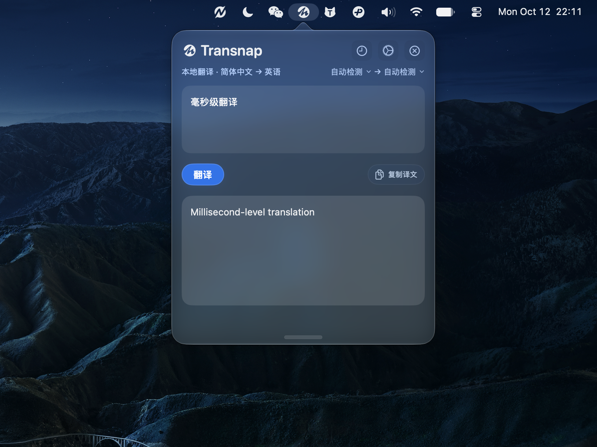

# Transnap

Transnap 已上线 App Store：[前往 App Store 下载](https://apps.apple.com/app/id6762361410)。

Transnap 是一个完全免费的 macOS 菜单栏翻译工具，主打“复制即翻”。它基于系统 `Translation` 框架进行本机翻译，通过菜单栏面板、全局快捷键和可选的双击复制快捷方式快速唤起，适合处理阅读、聊天、文档里的碎片文本。

当前源码采用纯本地翻译方案，没有会员购买或在线翻译服务，无需配置 API 密钥、Node.js 或 TypeScript 环境。

当前源码版本：

- Version: `1.3`
- Build: `55`
- 开源版默认 Bundle ID: `com.example.transnap`（可通过本地配置修改）
- Minimum macOS: `15.0`

## 项目截图



## 功能概览

### 菜单栏翻译

Transnap 启动后常驻菜单栏。点击菜单栏图标会展开翻译面板，并自动读取当前剪贴板中的纯文本填入输入框。

翻译面板支持：

- 自动读取剪贴板内容
- 手动输入或粘贴文本
- 自动或手动选择源语言与目标语言
- 一键复制译文
- 打开历史窗口和设置窗口

### 快捷键

默认全局快捷键：

- `Command + Shift + C`

用户可以在设置页重新录制快捷键。

> [!WARNING]
> 设置页还可以手动启用 `Command + C + C`，也就是按住 `Command` 连按两次 `C`。这个功能会在复制后快速显示翻译面板，需要 macOS“输入监控”权限；未开启权限时，默认全局快捷键和菜单栏点击仍可正常使用。

### 语言与显示

设置页支持：

- 应用显示语言：简体中文、English
- 外观：跟随系统、浅色、深色
- 常用自动检测语言对
- 翻译面板源语言和目标语言选择

自动检测模式会在用户设置的两种常用语言之间判断；其它语言可以在翻译面板中手动指定。

### 历史记录

每次成功翻译后都会生成一条 `TranslationRecord`，并通过 SwiftData 保存在本机。

历史窗口支持：

- 查看原文与译文
- 查看语言方向与时间
- 复制历史译文
- 删除单条记录
- 清空全部历史记录

设置页可以调整最多保存条数。新翻译写入后，应用会按设置的上限裁剪较旧记录。

默认保存上限为 50 条，可在设置中调整为 10–200 条。

### 开机启动

设置页支持“登录时自动打开”，通过 `SMAppService.mainApp` 接入 macOS 登录项。部分系统状态可能需要用户在系统设置的登录项中确认一次。

### 离线语言包

离线语言包页会读取系统 `Translation` 框架返回的语言资源状态，并在支持下载时通过 `prepareTranslation()` 触发系统准备离线翻译资源。已下载语言包由 macOS 系统设置统一管理。

### 关于与反馈

设置的“关于”页面提供反馈、X 和小红书入口。点击反馈按钮可以通过邮件发送问题；将鼠标移到反馈按钮上，可以查看并复制邮箱地址。

## 权限说明

### 剪贴板

Transnap 会读取当前剪贴板中的纯文本，用于自动填充和快速翻译。翻译完全在本机进行，不会上传文本；翻译历史也只保存在本机。首次使用某种语言可能需要联网下载 Apple 系统语言包，下载后可离线使用。

### 输入监控

双击复制功能默认关闭。只有用户在设置中确认启用 `Command + C + C` 时，Transnap 才会请求输入监控权限。

启用后，应用通过全局按键事件识别这个快捷方式，用于复制后快速显示翻译面板。应用不记录其他按键内容，也不上传按键事件。未授权时，该功能不会运行；默认全局快捷键和菜单栏点击仍可使用。

## 技术栈

- SwiftUI
- AppKit
- SwiftData
- Translation framework
- NaturalLanguage framework
- Carbon Hot Key API
- ServiceManagement

## 本地运行

### 开发环境

- macOS 15.0 或更新版本
- Xcode 26 或更新版本：源码使用 macOS 26 SDK 的 `glassEffect`，并为 macOS 15 提供兼容界面
- App 和测试源码均使用 Swift，依赖 Apple 系统框架，无需安装第三方软件包

### 用 Xcode

1. 克隆或下载仓库，打开 [Transnap.xcodeproj](Transnap.xcodeproj)
2. 将 `Config/Local.xcconfig.example` 复制为 `Config/Local.xcconfig`，填写自己的 `DEVELOPMENT_TEAM` 和唯一的 `TRANSNAP_BUNDLE_ID`。本地配置会应用于 App、单元测试和 UI 测试 target，并已被 Git 忽略
3. 选择 `Transnap` scheme 和本机 Mac，然后运行

```bash
cp Config/Local.xcconfig.example Config/Local.xcconfig
```

也可以直接在 Xcode 的 Signing & Capabilities 中为各个 target 选择自己的 Team 和 Bundle Identifier。开源版未包含作者的签名团队、证书或私钥。开源版默认 Bundle ID 与 App Store 版本不同，本地数据也独立保存。

运行后应用会以菜单栏工具形式存在，不会显示为普通 Dock 应用。

### 命令行构建

以下命令仅编译，不进行代码签名。构建产物放在临时目录中。

```bash
xcodebuild -project Transnap.xcodeproj -scheme Transnap \
  -configuration Debug -destination 'platform=macOS' \
  -derivedDataPath /tmp/Transnap-Debug CODE_SIGNING_ALLOWED=NO build
```

Release 构建：

```bash
xcodebuild -project Transnap.xcodeproj -scheme Transnap \
  -configuration Release -destination 'platform=macOS' \
  -derivedDataPath /tmp/Transnap-Release CODE_SIGNING_ALLOWED=NO build
```

配置好自己的签名后，运行单元测试：

```bash
xcodebuild -project Transnap.xcodeproj -scheme Transnap \
  -destination 'platform=macOS' -derivedDataPath /tmp/Transnap-Tests \
  -only-testing:TransnapTests test
```

当前两个 UI 测试均标记为跳过，不能作为界面行为已经验证的依据。

## 提交 App Store 前检查

建议通过 Xcode Organizer 走完整流程：

1. Product > Archive
2. Validate App
3. Distribute App / Upload

提交前重点确认：

- 版本号和 Build 号与计划发布的版本一致，Build 号高于之前已上传的构建
- 发布自己的版本时，使用自己注册的 Bundle ID 和开发者 Team
- Archive 产物包含 `arm64` 和 `x86_64`
- App Sandbox 已开启
- 最终上传包使用 App Store 分发签名，而不是本地开发签名
- 输入监控及双击复制功能与产品说明、审核备注一致
- 不要上传本地调试生成的 `.dmg`、`.xcarchive`、`.xcresult` 或 DerivedData

## 项目结构

```text
Transnap.xcodeproj/                  # Xcode 工程
Config/                             # 构建配置与 Info.plist
Transnap/
├── TransnapApp.swift                # 应用入口，初始化模型、菜单栏、设置和快捷键
├── ContentView.swift                # SwiftUI 预览
├── Assets.xcassets/                 # App、菜单栏和社交入口图标
├── Models/
│   └── TranslationRecord.swift      # SwiftData 翻译记录模型
├── Services/                       # 剪贴板、快捷键、语言包、窗口和用户设置
├── ViewModels/
│   └── TransnapViewModel.swift      # 翻译流程、状态管理、历史写入和裁剪
└── Views/                          # 翻译面板、历史窗口、设置和引导界面
TransnapTests/                      # 单元测试
TransnapUITests/                    # UI 测试入口，目前跳过执行
```

## 开源仓库说明

这个仓库从当前源码重新建立，未包含原私有仓库的提交历史。公开的反馈邮箱、社交账号、App Store 链接、应用资源和版权声明保留。

提交前请检查暂存区内容，不要上传 `Config/Local.xcconfig`、密钥、证书、个人 Xcode 配置或构建产物。

## License

本项目采用 [MIT License](LICENSE)，版权所有 © 2026 youngxkk。

允许使用、修改、商用和重新分发，需保留版权声明及许可证文本。第三方品牌标识的权利归各自权利人所有。
